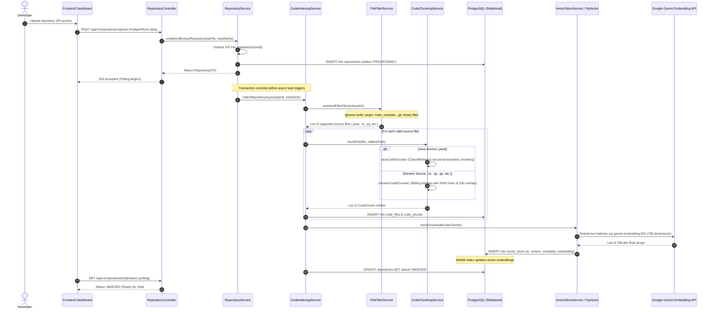
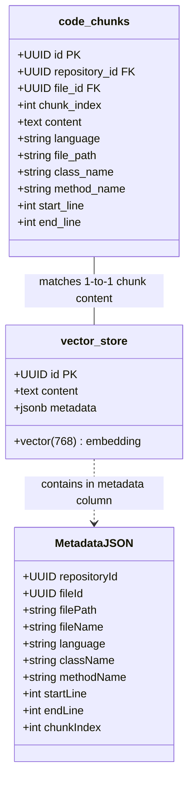
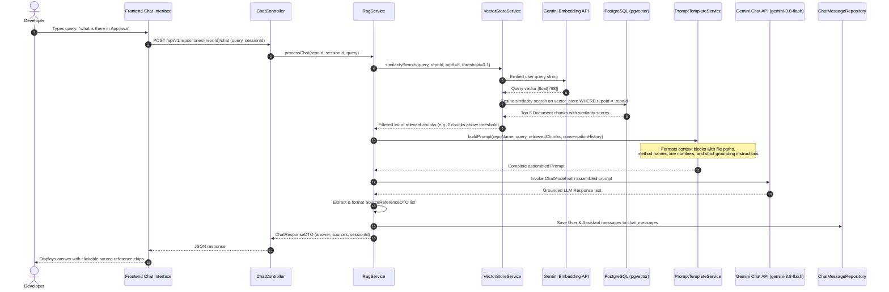

# DevPilot RAG Architecture & Data Flow

This document details the complete end-to-end architecture of DevPilot, covering the **Code Indexing Pipeline**, **Vector Storage Engine (pgvector)**, and the **RAG Retrieval & Generation Flow**.

---

## 1. High-Level System Architecture

```mermaid
graph TB
    subgraph Client["Frontend (React 19 + TypeScript + Tailwind)"]
        UI[User Interface & Chat View]
        UploadModal[Repository Upload Modal]
        SourceViewer[Source Code Modal]
    end

    subgraph Backend["Spring Boot 4.x Application"]
        RepoCtrl[RepositoryController]
        ChatCtrl[ChatController]
        IndexSvc[CodeIndexingService]
        FilterSvc[FileFilterService]
        ChunkSvc[CodeChunkingService]
        JavaChunker[JavaCodeChunker]
        GenericChunker[GenericCodeChunker]
        VectorSvc[VectorStoreService]
        RagSvc[RagService]
        PromptSvc[PromptTemplateService]
        EmbedModel[GeminiEmbeddingModel<br/>(com.google.genai.Client)]
        ChatModel[Spring AI ChatModel<br/>(GoogleGenAiChatModel)]
    end

    subgraph Storage["Persistence & Vector Database (PostgreSQL 16)"]
        Postgres[Relational Tables<br/>repositories, code_files, code_chunks, chat_messages]
        PgVector[(pgvector Extension<br/>vector_store table + HNSW Cosine Index)]
    end

    subgraph Gemini["Google Gemini Developer API"]
        EmbedAPI["Embedding API<br/>(gemini-embedding-001 / 768 dims)"]
        ChatAPI["LLM Generation API<br/>(gemini-3.8-flash)"]
    end

    %% Upload & Indexing Connections
    UploadModal -->|POST /upload| RepoCtrl
    RepoCtrl --> IndexSvc
    IndexSvc --> FilterSvc
    IndexSvc --> ChunkSvc
    ChunkSvc --> JavaChunker
    ChunkSvc --> GenericChunker
    IndexSvc --> Postgres
    IndexSvc --> VectorSvc
    VectorSvc --> EmbedModel
    EmbedModel --> EmbedAPI
    VectorSvc --> PgVector

    %% Chat & RAG Connections
    UI -->|POST /chat| ChatCtrl
    ChatCtrl --> RagSvc
    RagSvc --> VectorSvc
    VectorSvc --> PgVector
    RagSvc --> PromptSvc
    RagSvc --> ChatModel
    ChatModel --> ChatAPI
    RagSvc --> Postgres
    RagSvc --> UI
    SourceViewer -.->|GET /files/{id}| Postgres
```

---

## 2. Code Indexing Pipeline Flow

The indexing process converts raw codebase zip archives into structured relational records and searchable semantic vectors.



---

## 3. Vector Storage Architecture (pgvector)

Vector representations are stored and indexed inside PostgreSQL using the `pgvector` extension.



### Search Metric & Indexing
- **Distance Metric**: Cosine Distance
  $$\text{Cosine Distance} = 1 - \frac{\mathbf{u} \cdot \mathbf{v}}{\|\mathbf{u}\|_2 \|\mathbf{v}\|_2}$$
- **Index Type**: `HNSW` (Hierarchical Navigable Small World) for sub-millisecond approximate nearest neighbor (ANN) retrieval.
- **Repository Isolation**: All queries enforce metadata isolation:
  ```sql
  WHERE metadata->>'repositoryId' = :repoId
  ```

---

## 4. RAG Query Flow (Retrieval-Augmented Generation)

When a developer asks a question about the repository, DevPilot retrieves relevant code context before prompting the LLM.



---

## 5. Summary Table: Component Responsibilities

| Stage | Class / Service | Key Technology | Primary Output / Responsibility |
|---|---|---|---|
| **Filter** | `FileFilterService` | PathMatcher / MIME types | Excludes noise (`target`, `node_modules`, `.git`, binaries). |
| **Chunk** | `JavaCodeChunker` | Regex / AST heuristics | Extracts clean method/class chunks with line numbers. |
| **Chunk** | `GenericCodeChunker` | Sliding Window | 2,000 character windows with 200 character overlap. |
| **Embed** | `GeminiEmbeddingModel` | Google GenAI SDK | Produces 768-dimensional float arrays (`gemini-embedding-001`). |
| **Store** | `PgVectorStore` | PostgreSQL + `pgvector` | Persists vectors and metadata with HNSW cosine index. |
| **Search** | `VectorStoreService` | Spring AI `SearchRequest` | Fetches Top-K nearest code chunks for a specific `repoId`. |
| **Prompt** | `PromptTemplateService` | Structured String Templates | Enforces code grounding and prevents LLM hallucination. |
| **Answer** | `RagService` | `GoogleGenAiChatModel` | Invokes `gemini-3.8-flash` and constructs source citation chips. |
