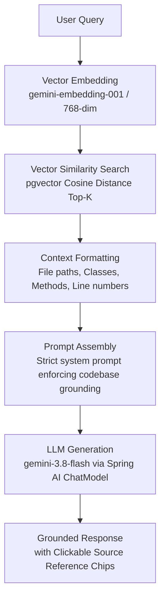

# DevPilot — AI Codebase Assistant

DevPilot is a full-stack, production-oriented AI Codebase Assistant powered by **Retrieval-Augmented Generation (RAG)**. It enables developers to import software repositories as ZIP archives, asynchronously index the source code with code-aware chunking and vector embeddings, and interactively ask questions in natural language with precise source file and line references.

---

## Features

- **Repository Ingestion & Safe Extraction**:
  - Secure ZIP upload with path-traversal protection and file size validation.
  - Multi-language source file discovery (`.java`, `.ts`, `.tsx`, `.js`, `.jsx`, `.py`, `.go`, `.kt`, `.xml`, `.yml`, `.json`, etc.).
  - Configurable directory and file exclusions (`target`, `build`, `node_modules`, `.git`, `dist`, lockfiles).

- **Intelligent Code Chunking**:
  - **Java-aware chunking**: identifies packages, classes, interfaces, records, methods, and line boundaries.
  - **Generic code chunking**: sliding window with configurable overlap and symbol detection for other languages.
  - Preserves metadata (file path, class name, method name, start/end line numbers).

- **Embeddings & Vector Database**:
  - Powered by **Spring AI** and Google Gemini GenAI embeddings (`text-embedding-004`).
  - Stored in **PostgreSQL + pgvector** using cosine similarity distance and HNSW indexing.

- **Grounded RAG Pipeline**:
  - Top-K semantic similarity retrieval with configurable similarity threshold.
  - Dedicated prompt engineering preventing hallucinations and strictly grounding answers in indexed codebase snippets.
  - Extensible architecture ready for future rerankers and hybrid search.

- **Developer-Tool Frontend**:
  - Modern dark-mode interface built with **React, TypeScript, Redux Toolkit, RTK Query, and Tailwind CSS**.
  - **Dashboard**: repository management, drag-and-drop ZIP upload, real-time polling of indexing progress (`totalFiles`, `processedFiles`, `totalChunks`).
  - **AI Assistant**: split-pane view with file explorer, conversation session history, and rich markdown rendering with copy-to-clipboard code blocks.
  - **Source Code Viewer**: read-only syntax viewer with line numbers and highlighted line ranges when clicking source reference chips.

---

## Architecture

```
                      +------------------------------------------+
                      |         React + Redux Frontend           |
                      |   (Dashboard, Chat, Source Viewer)       |
                      +--------------------+---------------------+
                                           | HTTP / REST (JSON)
                                           v
                      +--------------------+---------------------+
                      |       Spring Boot 4 Application          |
                      |                                          |
                      |  [Controller]  Repository, Chat, Files   |
                      |  [Service]     Repository, Chat, File    |
                      |  [Indexing]    Filter, Chunking Pipeline |
                      |  [AI / RAG]    RagService, VectorStore   |
                      +----------+--------------------+----------+
                                 |                    |
                 JDBC / JPA      v                    v  Spring AI / REST
            +--------------------+---+       +--------+---------+
            |  PostgreSQL + pgvector |       |   Google Gemini  |
            |  (Tables & Vectors)    |       |  (LLM & Embed)   |
            +------------------------+       +------------------+
```

---

## Tech Stack

| Component | Technology |
|---|---|
| **Backend Framework** | Spring Boot 4.x / Java 21 |
| **AI Abstractions** | Spring AI (Google Gemini GenAI, pgvector) |
| **Data Persistence** | Spring Data JPA, Hibernate |
| **Database & Vector DB** | PostgreSQL 16 + `pgvector` |
| **Frontend** | React 19, TypeScript, Vite, Tailwind CSS |
| **State Management** | Redux Toolkit & RTK Query |
| **Icons** | Lucide React |
| **Containerization** | Docker & Docker Compose |

---

## RAG Pipeline & Architecture

> For comprehensive sequence diagrams, database schemas, and data flow charts, see **[RAG_ARCHITECTURE.md](RAG_ARCHITECTURE.md)**.



---

## Database Schema

- **`repositories`**: ID, repository name, original file name, status (`UPLOADED`, `PROCESSING`, `INDEXED`, `FAILED`), total/processed file counts, total/processed chunk counts, storage path, timestamps.
- **`code_files`**: ID, repository foreign key, relative file path, file name, extension, language, file size, chunk count, full file content for source viewing.
- **`code_chunks`**: ID, repository foreign key, file foreign key, chunk index, code content, language, file path, class name, method name, start line, end line, creation timestamp.
- **`vector_store`**: pgvector-managed table storing document embeddings and JSON metadata.
- **`chat_sessions`**: ID, repository foreign key, session title, creation timestamp.
- **`chat_messages`**: ID, repository foreign key, session foreign key, role (`user` or `assistant`), content, serialized source references JSON.

---

## API Documentation

### Repositories
| Method | Endpoint | Description |
|---|---|---|
| `POST` | `/api/v1/repositories/upload` | Upload a ZIP archive (multipart/form-data) |
| `GET` | `/api/v1/repositories` | List all uploaded repositories |
| `GET` | `/api/v1/repositories/{id}` | Get repository details |
| `GET` | `/api/v1/repositories/{id}/status` | Get indexing status and file/chunk counters |

### Code Files
| Method | Endpoint | Description |
|---|---|---|
| `GET` | `/api/v1/repositories/{id}/files` | List all discovered source files in repository |
| `GET` | `/api/v1/repositories/{id}/files/{fileId}` | Get source file metadata and raw content |

### Chat & RAG
| Method | Endpoint | Description |
|---|---|---|
| `POST` | `/api/v1/repositories/{id}/chat` | Send question, retrieve context, receive grounded answer |
| `GET` | `/api/v1/repositories/{id}/chat/sessions` | List chat sessions for repository |
| `GET` | `/api/v1/repositories/{id}/chat/sessions/{sessionId}` | Get message history for a session |

### System
| Method | Endpoint | Description |
|---|---|---|
| `GET` | `/api/v1/health` | Backend health check |

---

## Local Setup

### 1. Prerequisites
- **Java 21** or later
- **Maven 3.9+** (or use included `./mvnw`)
- **Node.js 20+** and **npm**
- **Docker & Docker Compose**

### 2. Configure Environment
Copy `.env.example` to `.env` or set environment variables:
```bash
cp .env.example .env
```

Set your Google Gemini API key:
```bash
GEMINI_API_KEY=your_gemini_api_key_here
```

### 3. Start Database (PostgreSQL + pgvector)
```bash
docker compose up -d
```

### 4. Run the Spring Boot Backend
```bash
./mvnw spring-boot:run
```
Backend runs on `http://localhost:8080`.

### 5. Run the Frontend Dev Server
```bash
cd frontend
npm install
npm run dev
```
Frontend runs on `http://localhost:3000` with automated proxy to backend.

---

## Example Questions

Once a repository is indexed, you can ask questions such as:
- *"How is authentication implemented in this codebase?"*
- *"Explain the request flow for creating a user or processing an order."*
- *"Where is database transaction management handled?"*
- *"Which classes depend on RepositoryService or PaymentService?"*
- *"Where and how are exceptions handled?"*
- *"Explain this controller and list all endpoints it exposes."*
- *"What database entities exist and how are they mapped?"*

---

## Future Enhancements

- **Model Context Protocol (MCP)** integration for dynamic tool invocation.
- **Reranking & Hybrid Search**: Combining BM25 sparse keyword search with dense vector similarity.
- **AST-based parsing**: Tree-sitter or JavaParser for syntax tree decomposition.
- **Multi-repository workspaces**: Cross-codebase querying and architecture comparison.
- **Git Integration**: Direct GitHub / GitLab clone and webhook synchronization.
